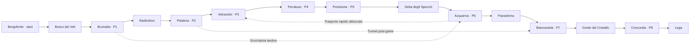

# VELORIA — World Map Design

**Versione:** 0.2 — Concept / macro-layout  
**Data:** 9 ottobre 2026  
**Stato:** Bozza di game design, nomi e collocazioni modificabili  
**Piattaforma:** PWA Phaser + TypeScript  
**Visione corrente:** RPG di esplorazione ortogonale **2D illustrato moderno**, con profondità pittorica morbida; 251 Pokémon Gen 1–2 e quattro starter. La precedente proposta HD pixel art è superata dalla direzione approvata in `docs/05_ART_DIRECTION_v0.3.md`.

## 1. Visione della regione

Veloria è una **penisola temperata** la cui topografia procede da boschi umidi e valli agricole a ovest, attraverso una metropoli circondata da parchi al centro, fino a distretti tecnologici e alla costa orientale. A nord una dorsale montuosa crea altitudini innevate; sulle colline nord-occidentali un microclima mite ospita antichi boschi di ciliegi.

Il contrasto tra natura e infrastrutture moderne non è un conflitto semplicistico: la tecnologia rende possibile una convivenza virtuosa, ma la **Rete di Risonanza**, infrastruttura energetica distribuita in tutta la regione, comincia a mostrare effetti inattesi sui biomi.

**Pilastri dell'esplorazione:**
1. *Meraviglia*: ogni macro-area deve avere una silhouette, palette e animazione ambientale riconoscibili.
2. *Leggibilità*: percorsi intuitivi, landmark visibili, pochi labirinti gratuiti.
3. *Ritorno significativo*: scorciatoie, missioni e incontri sbloccabili tornando nelle aree precedenti.
4. *Mondo vivo*: clima, luce e ciclo giorno/notte cambiano la scena e gli incontri.
5. *Espandibilità*: città, percorsi, dungeon e specie sono contenuti dichiarativi aggiungibili per pacchetti.

## 2. Macro-geografia — orientamento nord in alto

Questa matrice è uno **schema di collocazione, non una mappa disegnata in scala**.

| Nord-Ovest — colline fiorite | Nord — dorsale nevosa | Nord-Est — altopiano di equilibrio |
| --- | --- | --- |
| **Petalora [P2]** e foreste di ciliegi | **Biancavetta [P7]** e Passobrina | **Concordia [P8]**, Santuario e Lega |
| **Ovest — valle boscosa** | **Centro — grande conca urbana** | **Est — distretto energetico** |
| **Borgofonte**, Bosco dei Veli, **Brumalta [P1]**, Radicelmo | **Vetracielo [P3]**, parchi e linee sopraelevate | **Ferraluce [P4]**, Centrale Risonante e Riserva tecnica |
| **Sud-Ovest — bacino d'acqua dolce** | **Sud — pianure e delta** | **Sud-Est — costa** |
| **Acquariva [P6]**, lago e rive naturali | Delta degli Specchi, canali e fattorie | **Portolume [P5]**, porto e parco costiero |

La distribuzione delle Palestre segue un percorso a grande arco: **ovest → nord-ovest → centro → est → sud-est → sud-ovest → nord → nord-est**.

### Mappa dei collegamenti giocabili (topologia, non distanze)

## 3. Città e insediamenti

| Ordine | Luogo (provvisorio) | Identità e landmark | Funzione narrativa | Funzione gameplay |
| --- | --- | --- | --- | --- |
| 0 | **Borgofonte** | Case basse, canali, serre, piccole turbine, grandi alberi | Casa, ricercatrice locale, scelta starter; prima anomalia naturale | Tutorial, casa, laboratorio, 4 starter |
| 1 | **Brumalta** | **Città-parco** con edifici moderni fra alberi, passerelle verdi, giardini pensili | La prima dimostrazione di armonia natura-tecnologia | **Palestra 1 Normale**, Centro Pokémon, negozio, missione parco |
| — | **Radicelmo** | Villaggio-ponte fra foresta e alture, serra botanica | Custodi di un antico seme/archivio ecologico | Side quest, area di raccolta, scorciatoia |
| 2 | **Petalora** | **Ciliegi**, ponti di legno, terrazze, corsi d'acqua, luci calde | Tradizione locale e prime misure anomale della Risonanza | **Palestra 2 Erba**, micro-puzzle d'irrigazione |
| 3 | **Vetracielo** | **Metropoli con grattacieli**, monorotaia, parchi verticali, tetti accessibili | Sede dell'ente che coordina la rete energetica | **Palestra 3 Elettro**, snodo trasporti, quartieri ed edifici multipiano |
| 4 | **Ferraluce** | Acciaio, vetro, passerelle industriali, reattori sostenibili | Scoperta di test energetici non autorizzati | **Palestra 4 Acciaio**, dungeon Centrale Risonante |
| 5 | **Portolume** | Porto, skyline sul mare, moli, giardini costieri, energia eolica | Effetti della Risonanza sulle maree e rotte d'acqua | **Palestra 5 Acqua**, navigazione locale, pesca |
| 6 | **Acquariva** | Lago, canneti, quartieri su pontili, osservatorio | Gli ecosistemi acquatici registrano l'anomalia per primi | **Palestra 6 Psico**, puzzle riflessi e collegamento rapido |
| — | **Passobrina** | Piccolo borgo alpino, chalet contemporanei, stazione cabinovia | Rifugio e testimonianze dei cambiamenti climatici locali | Preparazione montagna, strumenti, missioni neve |
| 7 | **Biancavetta** | Case di pietra, cupole vetrate, neve, funivia, luci artiche | Emergenza alla sorgente della Risonanza | **Palestra 7 Ghiaccio**, ingresso grotte montane |
| 8 | **Concordia** | Città-giardino d'altura, architettura integrata in roccia e vegetazione, infrastrutture discrete | Ultima scelta: ripristinare un rapporto equilibrato con la rete | **Palestra 8 Drago**, sblocco del Santuario e della Lega |
| Finale | **Lega di Veloria** | Complesso monumentale tra roccia, acqua e vetro | Conclusione sportiva dell'avventura | Sfida finale, accesso al post-game |

**Regola:** tutte le Palestre devono essere raggiungibili senza scambi multiplayer. Le linee di trasporto rapido diventano disponibili progressivamente senza eliminare il valore dei percorsi a piedi.

## 4. Ordine delle Palestre

| # | Città | Tipo | Lezione di gioco | Puzzle proposto |
| --- | --- | --- | --- | --- |
| 1 | Brumalta | Normale | Cambi di Pokémon, uso di status e strumenti | Aprire varchi in un parco organizzando sentieri |
| 2 | Petalora | Erba | Efficacia dei tipi, copertura e alterazioni di stato | Deviare acqua tra terrazze di ciliegi |
| 3 | Vetracielo | Elettro | Immunità Terra e gestione della Velocità | Attivare linee della monorotaia in sequenza |
| 4 | Ferraluce | Acciaio | Difesa e scelta delle mosse | Riorientare nastri e campi magnetici |
| 5 | Portolume | Acqua | Cambi di tempo atmosferico, team balance | Controllo di chiuse e marea locale |
| 6 | Acquariva | Psico | Contromosse e status | Allineare specchi su pontili |
| 7 | Biancavetta | Ghiaccio | Preparazione e vantaggio di squadra | Passaggi su superfici ghiacciate |
| 8 | Concordia | Drago | Composizione squadra completa, strategia | Convergenza di elementi naturali e tecnologici |

**Bilanciamento starter:** la prima Palestra è Normale per evitare vantaggi strutturali iniziali. I Pokémon catturabili prima di P2–P3 forniscono risposte accessibili per tutti e quattro gli starter; Pikachu non impone un percorso differente.

## 5. Biomi, identità visiva e incontri esemplificativi

Le specie elencate sono proposte compatibili con le prime due generazioni; disponibilità e tassi d'incontro saranno definiti separatamente.

| Bioma | Aspetto e suono | Possibili Pokémon | Interazione distintiva |
| --- | --- | --- | --- |
| Bosco alto | Chiome a più livelli, luce filtrata, foglie mosse dal vento | Caterpie, Hoothoot, Oddish, Bellsprout | Erba fitta, sentieri nascosti, incontri notturni |
| Parchi urbani | Verde pensile, giardini curati, tram e acqua urbana | Pidgey, Sentret, Mareep | NPC, missioni cittadine e incontri limitati al parco |
| Ciliegi collinari | Petali al vento, ponti, acqua poco profonda | Hoppip, Sunkern, Natu, Vulpix | Petali che indicano correnti e tracce |
| Metropoli | Vetro, neon morbido, passerelle sopraelevate, pioggia riflettente | Magnemite, Voltorb, Porygon (evento) | Quartieri multilivello e monorotaia |
| Industria sostenibile | Tubazioni pulite, torri energetiche, pannelli | Magnemite, Grimer, Koffing | Interruttori, allarmi, linee energetiche |
| Costa e delta | Moli, dune, canali, vento e acqua animata | Tentacool, Krabby, Chinchou, Wooper | Pesca, barca, orari di marea come elementi scenici |
| Lago e paludi | Nebbia sull'acqua, pontili, ninfee | Poliwag, Marill, Goldeen, Wooper | Micropercorsi acquatici e riflessi |
| Montagna e neve | Cristalli, ghiaccio, conifere, bufere leggere | Swinub, Sneasel, Delibird, Seel | Ghiaccio scivoloso, passaggi tra quote |
| Riserva finale | Roccia, radici profonde, luce organica e macchinari inerti | Dratini, Larvitar, specie rare | Puzzle di sincronia e contenuti post-game |

**Tipi:** il roster iniziale usa i **17 tipi delle generazioni 1–2** (inclusi Buio e Acciaio, escluso Folletto). Le meccaniche moderne non vengono introdotte automaticamente solo perché presenti in PokéAPI.

## 6. Percorsi e collegamenti (16 route ID)

| ID | Tratta | Funzione principale |
| --- | --- | --- |
| R01 — Sentiero dell'Alba | Borgofonte → Bosco dei Veli | Movimento, prime catture, landmark |
| R02 — Viale delle Fronde | Bosco dei Veli → Brumalta | Uscita dal primo dungeon, visione della città-parco |
| R03 — Terrazze del Muschio | Brumalta → Radicelmo | Verticalità lieve, quest botanica |
| R04 — Salita dei Petali | Radicelmo → Petalora | Cambio di clima e primo scorcio dei ciliegi |
| R05 — Viadotto dei Ciliegi | Petalora → Vetracielo | Contrasto rurale/metropoli, binari panoramici |
| R06 — Anello Magnetico | Vetracielo → Ferraluce | Infrastrutture, prime anomalie evidenti |
| R07 — Condotto Risonante | Ferraluce → Centrale Risonante | Quest principale e dungeon tecnologico |
| R08 — Costa delle Turbine | Ferraluce → Portolume | Apertura sul mare, impianti eolici |
| R09 — Dune Salmastre | Portolume → Delta degli Specchi | Traversata costiera, ecosistemi di transizione |
| R10 — Sentiero delle Canne | Delta degli Specchi → Acquariva | Labirinto leggero, specie acquatiche |
| R11 — Via delle Cascate | Acquariva ↔ Vetracielo | Collegamento rapido disponibile a metà gioco |
| R12 — Valle del Vento | Acquariva → Passobrina | Passaggio pianura/montagna |
| R13 — Tornanti Bianchi | Passobrina → Biancavetta | Neve, ghiaccio, preparazione al settimo badge |
| R14 — Varco del Cristallo | Biancavetta → Grotte del Cristallo | Dungeon montano di avanzamento |
| R15 — Passo delle Due Luci | Grotte del Cristallo → Concordia | Rivelazione del nodo sorgente |
| R16 — Cammino dell'Equilibrio | Concordia → Lega | Sfida finale e senso di arrivo |

**Collegamenti tardivi aggiuntivi:** Brumalta ↔ Acquariva (passaggio naturale ripristinato) e Petalora ↔ Biancavetta (tunnel facoltativo post-game). Il trasporto ferroviario/metropolitano è una rete di fast travel separata dai percorsi esplorabili.

## 7. Dungeon e luoghi speciali

| ID | Area | Ruolo | Attivazione |
| --- | --- | --- | --- |
| D01 | **Bosco dei Veli** | Prima prova di orientamento, incontri e mini-evento | MVP, prologo |
| D02 | **Serra di Radicelmo** | Semi, irrigazione e puzzle di luce | Dopo P1, opzionale |
| D03 | **Centrale Risonante** | Infrastruttura compromessa, rivelazione narrativa | Dopo P4 |
| D04 | **Delta degli Specchi** | Percorsi fra canali, diversità acquatica | Fra P5 e P6 |
| D05 | **Grotte del Cristallo** | Altezza e temperatura, prova prima della città finale | Dopo P7 |
| D06 | **Santuario delle Due Luci** | Culmine della quest della Risonanza, eventuali incontri rari | Dopo P8 |

## 8. Archi narrativi e sblocco esplorazione

- **Atto I — Germoglio (inizio → P2):** scegliere lo starter, conoscere la rete energetica, vedere i primi segnali sottili. Sensazione di scoperta e sicurezza.
- **Atto II — La città e la rete (P3–P4):** il giocatore arriva nella metropoli; il programma di ricerca mostra incongruenze. Non tutti gli scienziati sono antagonisti.
- **Atto III — Onde di ritorno (P5–P6):** anomalie osservabili su costa e lago. Si aprono le prime scorciatoie di trasporto.
- **Atto IV — La sorgente (P7–P8):** si comprende che la Risonanza amplifica segnali naturali in modo instabile. Ricomporre l'equilibrio invece di distruggere la tecnologia.
- **Atto V — Lega e post-game:** Lega, riserve ad alto livello, quest per specie rare e completamento delle prime due generazioni.

La storia non richiede obbligatoriamente una fazione malvagia in stile classico: la principale pressione è un esperimento non autorizzato condotto da una **divisione della rete**, con dissenso interno e alleati nel mondo scientifico.

## 9. MVP — vertical slice della regione

**Confini giocabili:** Borgofonte, R01, Bosco dei Veli, R02, Brumalta e Palestra 1. Le uscite verso Radicelmo e Acquariva sono visibili ma bloccate narrativamente o da lavori sul percorso.

**Deve dimostrare:**
- un borgo naturale con piccoli dettagli tecnologici;
- una foresta con vegetazione alta stratificata e passaggi riconoscibili;
- una città-parco moderna con edifici, acqua, verde e pedoni;
- movimento touch, collisioni, camera, NPC, dialoghi e transizione tra mappe;
- quattro starter, prime specie selvatiche, cattura, combattimento, esperienza, evoluzioni pertinenti;
- un primo boss/Palestra Normale, checkpoint, salvataggio e gioco offline.

**Non deve implementare ancora:** metropoli completa, monorotaia funzionante, sistema completo di meteo, 251 specie utilizzabili, tutti i puzzle delle Palestre, seconda regione.

## 10. Regole tecniche per supportare espansioni

Ogni **mappa** possiede `mapId`, `version`, `biomeId`, `tilesetRefs`, `connections`, `npcRefs`, `encounterTableId`, `musicId`, `scriptRefs`, `unlocks`, `spawnPoints`. Gli ID sono permanenti: mai riutilizzarli per contenuti differenti.

Pacchetti indipendenti: `regions/`, `maps/`, `encounters/`, `quests/`, `trainers/`, `gyms/`, `pokemon/`, `assets/`. Le mappe sono create in **Tiled**, il motore carica il loro JSON e usa layer predefiniti (`ground`, `decoration`, `collision`, `overhead`, `interactables`, `triggers`).

La progressione si basa su **flag** ed eventi, non su controlli hardcoded del tipo “se è nella città X”. La partita salva la versione dello schema e dello stato contenuti, così da poter applicare migrazioni. Il gioco carica solamente gli asset della zona attuale e di quelle prossime; i pacchetti previsti per offline vengono precacheati prima di essere dichiarati disponibili.

**Punto legale:** le denominazioni e i personaggi Pokémon sono proprietà dei rispettivi titolari. Il progetto rimane un prototipo privato; l'uso privato non equivale a licenza e una futura distribuzione richiederebbe diritti appropriati oppure creature/asset originali.

## 11. Questioni aperte nella prossima revisione

1. **Forma della penisola:** compatta (brevi collegamenti) o ampia (più esplorazione).
2. **Ruolo dei trasporti:** metro come fast travel dopo P3; funivia dopo P7.
3. **Finale narrativo:** ripristino della Risonanza senza distruzione della rete.
4. **Vertical slice:** il primo capitolo è giocabile; restano QA su smartphone, armonizzazione visiva e sviluppo dei contenuti futuri indicati nel backlog.
